  

 

## 👋 About

I'm a **Front-End Developer** from Dhaka, Bangladesh. I build responsive, accessible interfaces and product experiences with **React, TypeScript, Next.js, and Tailwind CSS**.

My standout project is an **ISP billing and management system** ([rdnisp.com](https://rdnisp.com)) used by live ISPs, with bKash payments, role-based dashboards, and MikroTik automation. I previously worked as a Web Developer at **FB International BD** and am studying **CSE at Southeast University**. I'm open to front-end opportunities and collaborative product teams.

## 💻 Front-End Toolkit

### What I focus on

- Responsive, accessible interfaces and reusable UI
- React and Next.js application development
- Type-safe front-end development with TypeScript
- API integration, performance, and polished user experience

 

| Area | Technologies |
|---|---|
| **CMS & e-commerce** | WordPress, Shopify, WooCommerce, Elementor, Divi, WPBakery |
| **Data & ORM** | PostgreSQL, MySQL, SQL, Drizzle ORM |
| **Tools & design** | Git, GitHub, Vercel, VS Code, Android Studio, Photoshop, Illustrator |
| **Additional languages** | Python, C, C++, Java |
| **Product integrations** | REST APIs, bKash payments, role-based dashboards, MikroTik automation |

## 📊 GitHub Stats

<a href="https://github.com/Pronoysaha90">
  <picture>
    <source media="(prefers-color-scheme: dark)" srcset="https://github-readme-stats.vercel.app/api?username=Pronoysaha90&show_icons=true&hide_border=true&bg_color=0d1117&title_color=2563eb&icon_color=2563eb&text_color=c9d1d9&count_private=true&include_all_commits=true" />
    <source media="(prefers-color-scheme: light)" srcset="https://github-readme-stats.vercel.app/api?username=Pronoysaha90&show_icons=true&hide_border=true&bg_color=ffffff&title_color=2563eb&icon_color=2563eb&text_color=374151&count_private=true&include_all_commits=true" />
    
  </picture>
</a>
<a href="https://github.com/Pronoysaha90">
  <picture>
    <source media="(prefers-color-scheme: dark)" srcset="https://github-readme-stats.vercel.app/api/top-langs/?username=Pronoysaha90&layout=compact&langs_count=6&hide_border=true&bg_color=0d1117&title_color=2563eb&text_color=c9d1d9" />
    <source media="(prefers-color-scheme: light)" srcset="https://github-readme-stats.vercel.app/api/top-langs/?username=Pronoysaha90&layout=compact&langs_count=6&hide_border=true&bg_color=ffffff&title_color=2563eb&text_color=374151" />
    
  </picture>
</a>

 

